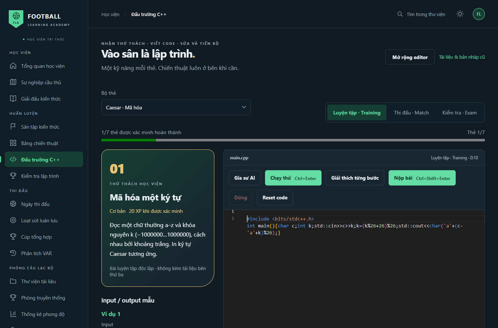

# Classical Cryptography Learning Lab

Nền tảng tự học mật mã cổ điển qua bài tập C++, mang giao diện **Football Learning Academy**. Luồng chính: **đọc đề → viết code → chạy thử → đọc lỗi → tự sửa → nộp bài** trong cùng một màn hình.

Đây là dự án học tập và portfolio, không phải công cụ mã hóa dữ liệu thật hay dịch vụ chấm bài Internet đã được kiểm toán bảo mật. Repository công khai mã nguồn; **chưa có website được deploy công khai**.

## Mục tiêu học tập

- Hiểu biểu diễn ký tự, số học modulo, thay thế và hoán vị.
- Tự viết C++ từ các thẻ nhỏ đến bài tổng hợp; luyện xử lý khóa âm, chuỗi rỗng và định dạng output.
- Xây dựng ứng dụng React/TypeScript có backend, lưu tiến độ và kiểm thử tự động.
- Học cách phân biệt dữ liệu thực thi thật, mô hình thuật toán và phân tích tĩnh.

## Thuật toán và phạm vi thực tế

Bản demo độc lập có **13 mục học và 28 thẻ C++**. Không kèm PowerPoint, trích đoạn bài giảng hoặc dữ liệu học cá nhân.

| Chủ đề | Đã có trong thẻ lập trình |
| --- | --- |
| Caesar | Ký tự/chuỗi, hoa thường, mã hóa/giải mã, khóa âm, vét cạn và bài tổng hợp |
| Affine | Nghịch đảo modulo, mã hóa/giải mã với kiểm tra khóa |
| Monoalphabetic | Kiểm tra hoán vị khóa, thay thế và khôi phục ký tự |
| Vigenère | Mã hóa/giải mã với khóa lặp |
| Vernam/XOR | Hai bit và chuỗi nhị phân |
| Rail Fence | Tách và ghép **hai hàng** |
| Hoán vị cột | Lưới **3×3** và thứ tự cột |
| Hill | Nhân vector/cặp ký tự; chưa là thư viện Hill tổng quát |
| Playfair | Tạo bảng khóa và xử lý cặp ký tự; chưa chuẩn hóa toàn bộ văn bản đầu vào |
| Feistel | Một/hai vòng thu nhỏ; không phải DES hoàn chỉnh |
| DES/AES | Mục giới thiệu khái niệm; **chưa triển khai mã hóa DES/AES đầy đủ** |

## Tính năng

- Monaco Editor cục bộ, giữ bản nháp theo thẻ và Training/Match/Exam.
- Chạy C++ thật, stdin/stdout/stderr, diagnostic compiler theo dòng/cột, Dừng và Reset có hoàn tác.
- Nộp bài với bộ test riêng; chỉ cấp XP một lần khi accepted, Run không cấp XP.
- Ctrl+Enter để chạy, Ctrl+Shift+Enter để nộp; xem lịch sử, gợi ý và lời giải theo chế độ.
- Giải thích tĩnh theo dòng; mô hình Caesar độc lập có bảng biến trước/sau, điều kiện, vòng lặp, bảng chữ cái và timeline. **Chưa có debugger hoặc runtime variable trace.**
- SQLite lưu tiến độ, chế độ học, backup/restore có kiểm tra; hỗ trợ biên soạn bài/thẻ thủ công và nhập tài liệu riêng ở local.
- Panel Gia sư AI, hỏi về vùng code chọn, adapter hội thoại nhiều lượt. **Chưa kết nối/kiểm chứng mô hình thật**; test provider là MOCK, không phải nghiệm thu chất lượng dạy. Mỗi lượt gửi cần đồng ý; khóa chỉ ở backend. Hội thoại hiện lưu trong trình duyệt, chưa nằm trong backup SQLite. Xem [hướng dẫn gia sư](docs/tutor.md).

## Công nghệ

React 19, TypeScript, Vite, Monaco Editor; Express 5, Zod, SQLite tích hợp Node.js 24; Clang/LLVM WASM, WASI shim và Windows Job Object; Node test runner, Supertest, ESLint, Playwright.

### Compiler và chế độ ICPC

Runner hiện được xác minh trên **Windows x64 + Node.js 24**. Compiler thực tế **Clang 22.1.6**, libc++ **220106**, `-std=gnu++17`; gói dependency là `@yowasp/clang@22.0.0-git20695-13` (phiên bản gói khác binary bên trong).

`#include <bits/stdc++.h>` được hỗ trợ qua **lớp header tương thích ICPC** tổng hợp các header tiêu chuẩn libc++ trong filesystem ảo. Không thay mã người học. Đây **không phải GNU G++/GNU libstdc++**, không đảm bảo PBDS, `__gnu_cxx` hay toàn bộ GNU extensions.

Không chạy mã học viên thành executable Windows native. Chương trình WASM có 64 MiB RAM, 2 giây/test, 64 KiB output; worker có giới hạn 1,5 GiB, 15 giây CPU, compiler timeout 25 giây; 1 tác vụ đồng thời. Không preopen thư mục host, không cấp network cho chương trình. Chưa hỗ trợ exceptions, threads hoặc API Windows. Trên nền tảng khác, phần web có thể chạy nhưng C++ runner hiện chưa được hỗ trợ/kiểm chứng.

## Cài đặt và chạy local

Yêu cầu: Node.js 24 trở lên, npm; Windows x64 để dùng runner đầy đủ. Toolchain WASM được npm cài vào dự án, không cần G++ native. Lần cài đầu có dependency toolchain khoảng 100 MB.

```powershell
git clone https://github.com/Noname000-Zero/classical-cryptography-learning-lab.git
cd classical-cryptography-learning-lab
npm ci
npm run build
npm start
```

Mở **http://127.0.0.1:3001**. Bản clone mới dùng `data/demo-catalog.json`; dữ liệu phát sinh lưu riêng tại `data/runtime/` và được Git bỏ qua. Không cần 11 bài giảng để chạy demo. Nếu đã có catalog private local, server ưu tiên giữ catalog đó; không tự thay dữ liệu đã seed.

Phát triển với `npm run dev`: frontend http://127.0.0.1:5173, API cổng 3001. Không chạy hai backend cùng cổng. App không tự đọc `.env`; `.env.example` mô tả các biến môi trường tùy chọn. Chưa cung cấp bộ cài/tự khởi động sau đăng nhập cho bản portfolio.

## Kiểm thử

```powershell
npm run typecheck
npm run lint
npm test
npm run build
npm run test:browser
```

Browser test dùng Chrome ở đường dẫn Windows thông thường; nếu khác, đặt biến `CHROME_PATH`. QA chạy cổng 3101 và database tạm, không dùng tiến độ thật. Các test runner chạy C++ thật, STL ICPC, 28 lời giải, test biên/ẩn, giới hạn tài nguyên, API Run/Submit và XP/backup. Chúng chỉ chạy runner trên Windows x64; xem kết quả skip nếu dùng hệ điều hành khác. Tutor dùng provider giả lập cho test và ghi nhãn rõ. `npm run catalog` chỉ tái tạo demo độc lập, không quét thư mục bài giảng.

## Cấu trúc

```text
web/                 Giao diện học, Monaco, runner, giải thích và tutor
server/              API, SQLite, bộ chấm và sandbox worker
migrations/          Schema dữ liệu, nâng cấp bảo toàn tiến độ
data/demo-catalog.json  Nội dung demo độc lập được công khai
tools/               Parser, tạo demo và server QA
tests/               Test độc lập với tài liệu riêng
docs/                Hướng dẫn, ảnh và nghiệm thu public
```

## Hình ảnh



Ảnh chụp từ database QA với dữ liệu demo; không phải dữ liệu học cá nhân hay bằng chứng AI thật đã kết nối.

## Dữ liệu, nguồn và đóng góp

- Không công bố 11 bài giảng PowerPoint hoặc nội dung trích xuất, tên nguồn, inventory; quyền phân phối các tài liệu đó chưa được xác định.
- Không commit database, bản nháp, XP, backup, file người dùng nhập, API key, `.env`, cache, `node_modules` hoặc build output.
- Catalog demo được biên soạn độc lập cho repository, không sao chép nội dung bài giảng. Mã nguồn có sử dụng thư viện bên thứ ba qua npm; xem [ghi chú nguồn](docs/SOURCES.md).
- Chủ dự án định hướng yêu cầu, lựa chọn trải nghiệm học và nghiệm thu. AI hỗ trợ viết mã, tích hợp, sửa lỗi và kiểm thử; không mô tả toàn bộ là mã tự viết thủ công.
- Chưa chọn giấy phép mã nguồn riêng; repository public không đồng nghĩa đã cấp một giấy phép nguồn mở cụ thể.

## Hướng phát triển

- Kết nối và nghiệm thu buổi học thật với mô hình AI; đồng bộ/sao lưu hội thoại trong SQLite.
- Mở rộng mô hình từng bước ngoài Caesar, tích hợp debugger có trace đáng tin cậy.
- Runner GNU G++/libstdc++ thật trong môi trường Linux cô lập, hỗ trợ nhiều nền tảng.
- Tăng độ phủ bài toán, accessibility và kiểm thử trình duyệt.
- Nếu triển khai Internet: cần thiết kế xác thực, phân quyền dữ liệu, hàng đợi/quota bền vững, kiểm toán sandbox, quản lý khóa, HTTPS và giám sát. Backend hiện chỉ chấp nhận loopback, **không phải bản sẵn sàng phục vụ công khai**.